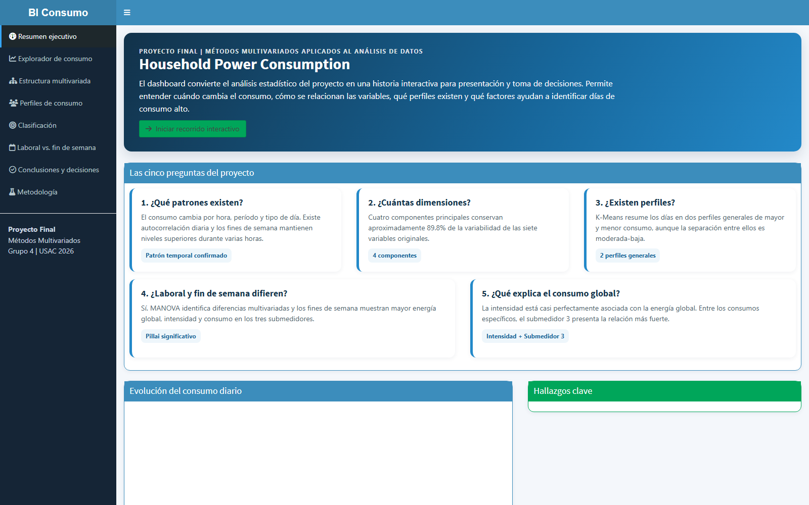

# Dashboard multivariado de consumo eléctrico

Proyecto académico realizado durante la **Maestría en Estadística Aplicada** de la
Universidad de San Carlos de Guatemala, dentro del curso de Métodos Multivariados
Aplicados al Análisis de Datos.

> El proyecto original fue desarrollado en equipo. Esta versión de portafolio fue
> preparada por Raúl Antonio Ruano Katz y omite registros académicos y otros datos
> personales.



## Objetivo

Identificar patrones multivariados de consumo eléctrico residencial y comunicar
los resultados mediante un dashboard interactivo desarrollado con R Shiny.

## Funcionalidades

- resumen ejecutivo e indicadores de consumo;
- exploración temporal por fecha, hora y tipo de día;
- análisis de componentes principales (PCA);
- clustering jerárquico y K-means con evaluación silhouette;
- perfiles de consumo energético;
- clasificación mediante regresión logística;
- comparación laboral frente a fin de semana;
- análisis de observaciones multivariadas atípicas;
- tablas y gráficos interactivos con Plotly y DT.

## Estructura

```text
├── app.R
├── requirements.R
├── data/
│   ├── daily_energy_metrics.csv
│   └── hourly_energy_metrics.csv
└── www/
    └── dashboard-preview.png
```

Los CSV contienen métricas agregadas derivadas del caso Household Power
Consumption; no contienen nombres ni identificadores personales.

## Ejecución

Requiere R 4.x:

```r
source("requirements.R", encoding = "UTF-8")
shiny::runApp(".")
```

También puede iniciarse con `Rscript run_app.R`; por defecto utilizará el puerto
local 7777.

## Alcance

El dashboard es una demostración académica de análisis multivariado y no un
sistema de monitoreo eléctrico en producción.

